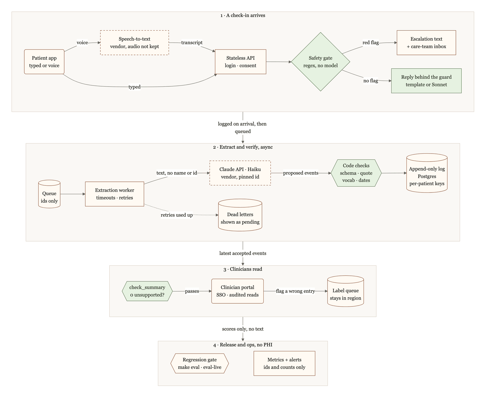

# Chronicle in production: architecture and rollout (future)

> **Status:** a plan, not built. The [README](../README.md) describes the offline demo that exists today.

The goal: real patients send daily check-ins, typed or voice, and clinicians read summaries where every line cites the patient's own words. Three principles carry over from the demo: **safety is code, not a model** (the safety gate runs before any model call and the guard checks every reply), **the model proposes and code decides** (schema, quote check, vocabulary and dates in code, an append-only event log, summaries that must pass `check_summary`), and **nothing ships unmeasured** (the eval harness and regression gate). Green nodes in the diagram run demo code unchanged. No certification is claimed; legal and clinical points need confirming by counsel and a clinical safety lead.

*Green: runs the demo's code unchanged. Dashed: an outside vendor, used only under a business associate agreement (BAA, HIPAA) or a data processing agreement (DPA, GDPR). PHI: protected health information. Diagram source: [diagrams/architecture-production.mmd](diagrams/architecture-production.mmd).*

## How one check-in would flow
1. **Send.** The patient signs in and sends a typed check-in or a voice note; speech-to-text, under a business associate agreement (BAA) or data processing agreement (DPA), turns the note into the message text, and the audio is not kept by default.
2. **Gate.** The stateless API checks consent and runs `detect_flags` unchanged, in the request and before any model call, with the meds on file from `build_profile` (the demo runs it only in `/api/ask` and the safety suite, never on logged check-ins). A red flag gets the fixed escalation text at once and an item in the care-team inbox.
3. **Store.** The message, its flags and its queue job are written in one transaction with an arrival sequence, so every check-in reaches the timeline, flagged or not. A client-made `msg_id` makes a retried send a no-op, as `INSERT OR IGNORE` does in `store.ingest` today; the send time is kept in UTC with the patient's time zone, because `resolve_date` needs the local day.
4. **Reply.** With no flag, the reply goes through `GatedResponder`, so `guard` still replaces any reply that endorses a dose change, stopping meds or a self-diagnosis. The template is the default; an optional Sonnet reply falls back to it on timeout, and no reply waits on extraction.
5. **Extract.** A worker takes the job (ids only) and calls Haiku, if `make eval-live` confirms it, with today's `SYSTEM_PROMPT` and `record_events` tool, sending what `AnthropicExtractor` sends now: condition ids, channel and text, never the patient's name or id. Timeouts, backoff and rate budgets are explicit (the demo sets only `max_retries=3`); when attempts run out, the job goes to a dead-letter queue and the check-in shows as pending, where today an API error leaves zero events and looks like "nothing reported".
6. **Check and append.** `validate_extraction` runs in the worker exactly as today: Pydantic schema, verbatim quote check, vocabulary with brand to generic, dates resolved in code. One transaction appends a run (model id, prompt hash, vocab version, git SHA) with its events and rejects; a run is unique per message and version, so a redelivered job adds nothing.
7. **Read.** Clinicians sign in with SSO and see only consenting patients on their care team; every read is audited. `profile.py` and `summary.py` use the latest accepted run per message, ordered by arrival rather than insert order, so a retried job cannot beat a later correction; pending check-ins show as pending, not as quiet days. A summary is shown only if `check_summary` finds 0 unsupported claims (a failing model-written one falls back to `build_summary`), labelled patient-reported.
8. **Learn.** A clinician can flag a wrong entry: a flag row is appended and the event shows as disputed. Flagged messages, a random sample, and messages where the model and the rules baseline (run alongside at no API cost, never shown) disagree are labelled in the `facts.json` format, so `metrics.py` scores them unchanged; labels stay in the region and only scores reach the regression gate. Logs and metrics carry ids and counts, never message text.

## Demo today vs production
| | Demo today | Production |
|---|---|---|
| Data | 16 synthetic patients from seeded `gen.py` | Consenting real patients; the synthetic set stays the eval set on every PR |
| Access | No login; anyone who reaches the server can open any patient | Patient login, clinician SSO, care-team checks on every request, every read audited |
| Privacy | Synthetic data in plain local files | Health data (PHI under HIPAA, special-category data under GDPR): TLS, encryption at rest, per-patient keys, one deployment per data region, a BAA or DPA with every vendor that sees it |
| Hosting | One uvicorn process; `_patients` and `_fallback` in process globals; key in a git-ignored `.env` | Stateless containers behind TLS; state only in the database and queue; a secrets manager sets env vars, which `load_env` already lets win over `.env` |
| Voice | Synthetic text written to look like transcripts | Speech-to-text under a BAA or DPA; the transcript is the message text; audio not kept by default |
| Safety gate | `/api/ask` and the evals only; meds from the request; US numbers (911, 988) | Every check-in, before any model; meds on file; per-country text signed off by a clinician; escalation inbox |
| Extraction | Inline batch in `runner.py`; a failed call leaves 0 events, counted only in `perf`; the `extractor` column holds only the model id | Queue workers with timeouts, backoff, budgets and a dead-letter queue; failures show as pending; every run tagged with model id, prompt hash, vocab version and git SHA |
| Event log | SQLite; triggers block UPDATE/DELETE on `events` only; `seq` is send order only because ingest is sequential | Managed Postgres (e.g. RDS); messages, runs, events, rejects and flags append-only by triggers and grants; arrival order fixed at ingest; point-in-time recovery |
| Summary | `check_summary` result returned next to the summary | Served only if `check_summary` passes, else `build_summary`; labelled patient-reported |
| Releases | `make eval` and `make baseline` by hand; no baseline means the gate skips; `make eval-live` not run yet | Required CI on every PR; a missing baseline fails; `make eval-live` on any prompt, model, vocab or rule change; failures block deploys |

## Rollout plan
**Phase 1: Harness first (synthetic data, no PHI).**
- Run `make eval-live`, fill `pricing.json` and pick the extraction model by the README rule; repeat runs to see how much live scores vary before trusting the 2-point limit.
- Make `make test` and `make eval` required CI checks. The regression gate also fails on a missing baseline, a drop on negation, other_person or hypothetical, any quote-check leak, any unsupported claim or missed planted error in the summary check, and compares a new model id with the current one instead of passing it unchecked.
- Grow those three traps in `gen.py`: at 17 to 20 key events each, one flipped event moves a score 5 to 6 points.
- **Exit:** each planted regression above fails CI, and the first Haiku vs Sonnet numbers are published with cost.

**Phase 2: Production skeleton (still synthetic).**
- Build the Postgres log (runs, arrival order, append-only grants), queue, workers, dead-letter queue, stateless API, logins, audit log, per-patient keys and metrics.
- Replay all 849 check-ins while killing workers and injecting timeouts, rate-limit errors and malformed tool output; set latency and freshness targets from what that shows.
- **Exit:** `make eval` through the new path matches the SQLite numbers exactly (the rules baseline is deterministic), 0 of 849 injected inventions reach the log, nothing is lost or duplicated, and every failed call leaves a pending check-in with 0 events.

**Phase 3: Shadow pilot (one clinic, consenting patients; gate and guard live, nobody acts on extraction).**
- First: a BAA or DPA with every vendor that sees PHI, a HIPAA risk analysis and a GDPR data protection impact assessment, reviewed consent text and an incident runbook. A named clinical safety lead signs off the red-flag patterns and escalation text and re-labels the 41 hand labels.
- Label flagged, sampled, voice and disagreement messages, two labellers on a subset; real phrasings join the 35 safety cases as synthetic rewrites, so no real text enters git.
- `unknown_symptom` and `unresolvable_date` rejects list new slang and date phrases for `vocab.py` and `dates.py`; the rules baseline becomes the outage fallback only if it passes the gate on real language, otherwise check-ins wait as pending.
- **Exit:** strict F1 and per-trap scores on the real set meet thresholds the clinical lead set in advance, the gate passes on synthetic and real sets together, and an LLM judge is used only with 0 false passes on the re-labelled set.

**Phase 4: Clinicians read summaries, then voice and more clinics.**
- Every model or prompt change goes through the offline gate, the live gate, a shadow run (events never shown), then a canary; model ids stay pinned, and Sonnet replies stay off unless gated Sonnet passes all 35 safety cases.
- Voice reaches clinicians only after speech-to-text passes its own eval on drug names, numbers and red-flag phrases; a new region needs in-region endpoints, local crisis text and its own labelled slice.
- **Exit** (to wider use): every version that served clinicians passed both gates and a shadow period, no summary that failed `check_summary` was shown, and clinical and legal sign-off is in place, which no eval replaces.

## Risks and open questions
- **Synthetic scores will not transfer.** The same author wrote the messages and the rules baseline, so no accuracy claim about real patients holds until Phase 3 labels exist; who labels, and how much clinician time that takes, is open.
- **The safety gate is regex, and someone must own its alerts.** Misspellings, unusual phrasing and other languages slip past, unseen unless messages the gate passed are sampled too. If meds on file come only from extraction, a missed med start silences the fever rule. Who watches the escalation inbox, and when, is a clinical decision; until a clinic commits, the app must say check-ins are not monitored in real time.
- **Voice errors happen before every check.** The quote check and the gate both read the transcript, so a misheard drug name, number or red-flag phrase passes both; a failed or slow transcription still needs a fixed "if this is urgent, call your emergency number" reply.
- **Cited is not the same as correct.** The quote check stops invented quotes, not a real quote attached to the wrong symptom, severity or date. Risk scores, triage ranking or flare prediction would likely make Chronicle a regulated medical device; even the gate and "trending up" lines need intended-use wording checked by regulatory counsel.
- **Append-only vs erasure.** Whether destroying a patient's key counts as erasure, how long records must be kept and who is the controller vary by jurisdiction and contract; triggers also block backfills, so schema changes add columns or rows and never rewrite old ones.
